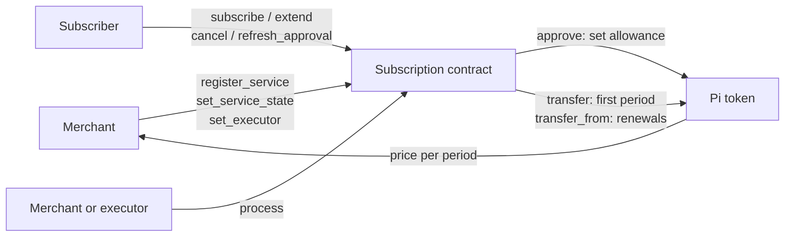
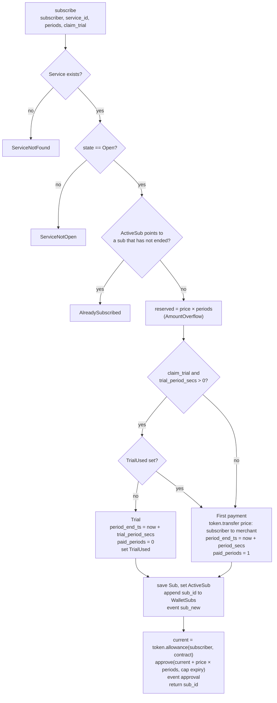
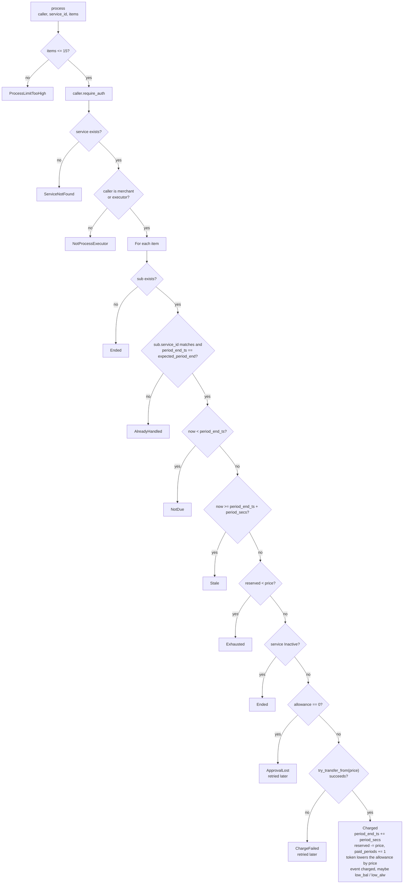
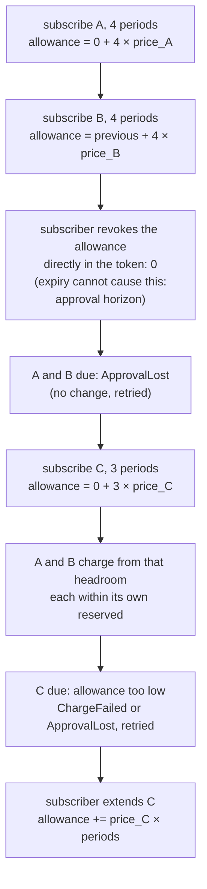
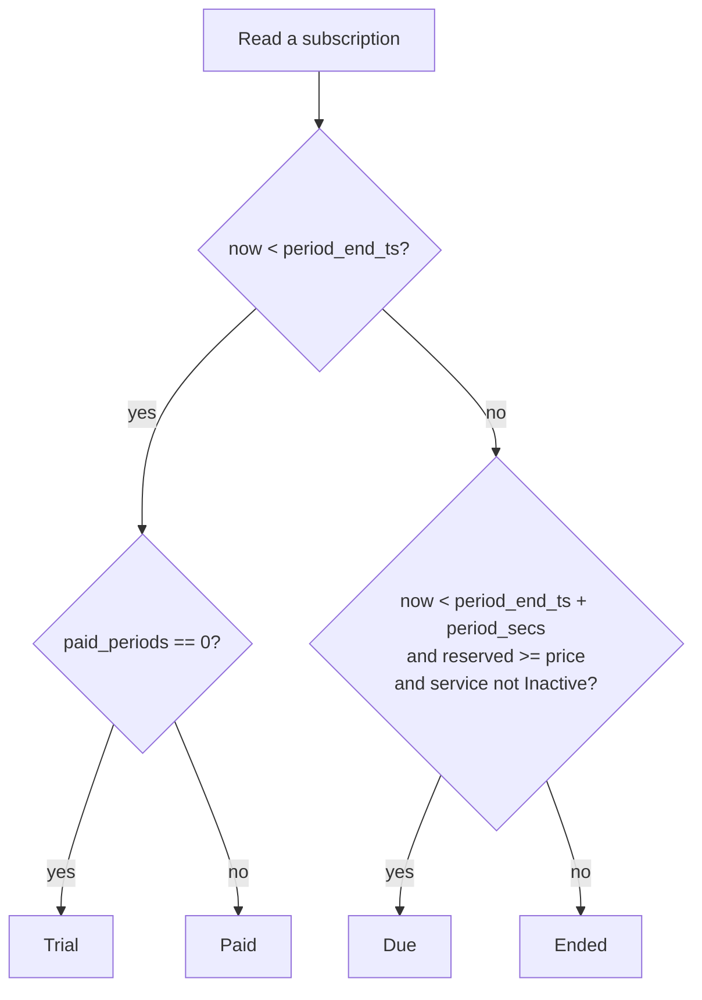

## 2. Overview

A Soroban smart contract for **recurring payments** on Pi Network. Merchants register services with a fixed price and billing period. Subscribers subscribe with a budget of whole periods. The merchant, or its executor, collects each period's payment from the subscriber's token allowance.

### 2.1 Roles

| Role | Who | Can do |
|---|---|---|
| Merchant | The address that registered a service; receives every charge | `register_service`, `set_service_state`, `set_executor`, `process` for its own services |
| Subscriber | The wallet that pays | `subscribe`, `extend`, `cancel`, `refresh_approval` for its own subscriptions |
| Executor | An optional key the merchant sets per service | `process` for that service only. It cannot change the service or receive funds. |
| Admin | Set at deploy | Propose and accept a new admin; propose, apply and cancel upgrades (7-day timelock) |

Anyone can call the read methods.

### 2.2 Key concepts

**Service terms are immutable.** A service's `merchant`, `price`, `period_secs` and `trial_period_secs` never change after `register_service`. A new price means a new service. Only `state` changes.

**Service state.** `Open` accepts sign-ups. `SignupsClosed` refuses new sign-ups, but existing subscriptions keep renewing. `Inactive` is final: no sign-ups and no charges; existing subscriptions run to their `period_end_ts` and then end.

**Period windows.** Each subscription has a `period_end_ts`: the end of the paid (or trial) period. The next charge may land only in the window `[period_end_ts, period_end_ts + period_secs)`. A charge moves `period_end_ts` forward by exactly `period_secs`, counting from the old value, not from the time of the charge. Windows are back to back, so at most one charge lands per period and billing never drifts. If no charge lands before the window closes, the subscription has ended.

**Reserved budget.** Each subscription has `reserved`: the approved budget it can still spend, always a whole number of prices. `subscribe` and `extend` add `price × periods`. Each charge takes one `price`. `cancel` sets it to 0. A subscription renews only while `reserved >= price`. The first payment at `subscribe` is a direct transfer and does not come from `reserved`.

**Shared allowance, adjusted on top.** The Pi token holds one allowance per (subscriber, contract), and only the subscriber's signature can change it. The contract keeps no copy of it. Every call the subscriber signs reads the token's current allowance and approves that value plus or minus the call's own change:

- `subscribe` and `extend` add `price × periods`;
- `cancel` subtracts the subscription's remaining budget;
- `refresh_approval` keeps the amount.

The expiry is always the cap, about 180 days. `subscribe` and `extend` refuse a budget whose last charge window would close after that expiry minus 7 days (`BeyondApprovalHorizon`), so the allowance cannot lapse while an accepted budget remains, as long as ledgers average at least about 4.81 s ([10.15](10-security-considerations.md#1015-known-limitation-ledger-speed-and-the-approval-horizon)); a subscriber can prepay at most about 170 days ahead. Budget of subscriptions that end without being charged stays in the allowance. Details in [6.6](6-subscription-lifecycle.md#66-the-shared-allowance).

**Per-subscription guards.** A charge is bounded by the subscription's own budget (`reserved`), its own window and its own service's merchant, whatever the shared allowance says. A subscription can never take more than the budget the subscriber gave it. Charges of different subscriptions can compete for the shared number when it is low; see [6.7](6-subscription-lifecycle.md#67-per-subscription-guards-and-accepted-limitations).

**Wallet index.** `WalletSubs(subscriber, page)` lists every `sub_id` a wallet ever created, 50 per page, including subscriptions created by calling the contract directly. It is append-only.

**Explicit billing.** `process` takes up to 15 items, each a `sub_id` with the `period_end_ts` the caller expects. If that value has already moved, the item is skipped. So a retried or duplicated batch charges nothing twice.

**Guardrails on-chain.** One live subscription per (subscriber, service); an ended subscription can never be extended. One free trial per (subscriber, service), ever. Sign-ups only on `Open` services. These hold for every caller.

**Derived status.** Status is never stored. Reads compute `Trial`, `Paid`, `Due` or `Ended` from the stored fields and the current time.

**Versioned records.** Every stored record is a versioned enum (`V1` today). Enum variants and error codes are append-only. Read methods return view structs, never the stored record. This lets later versions add fields without breaking stored data.

### 2.3 Subscribe

`TrialUsed` is read only when `claim_trial` is true and the service has a trial. `period_end_ts` is checked for `TimestampOverflow`. If the first payment fails (for example, low balance), the whole call fails and nothing is written.

### 2.4 Process: the charge rule

`process(caller, service_id, items)` first checks the call as a whole, then applies this rule to each item in order. The first check that fails decides the item's outcome. One item never makes the whole call fail.

Every outcome other than `Charged` changes nothing. The allowance is read once per subscriber per call and lowered by each charge in that call. The transfer is always exactly `price`, to this service's merchant.

### 2.5 The shared allowance over time

One wallet, add-on-top approvals, and how a direct revoke makes subscriptions compete for the shared number (the A/B/C example in [6.7](6-subscription-lifecycle.md#67-per-subscription-guards-and-accepted-limitations)):

### 2.6 Status

`Trial`, `Paid` and `Due` count as active. `Ended` is final: an ended subscription is never charged or extended again. To continue, the subscriber subscribes again. `status` is computed from the stored fields and the clock; it does not read the token allowance. A cancelled subscription is not ended until its `period_end_ts`, and `extend` before then undoes the cancel.

### 2.7 Security

See [`10-security-considerations`](10-security-considerations.md) for who can spend the allowance, what the token and the contract each enforce, storage expiry, executor keys and upgrades.

Next: [`3-Data-Types`](3-data-types.md)
