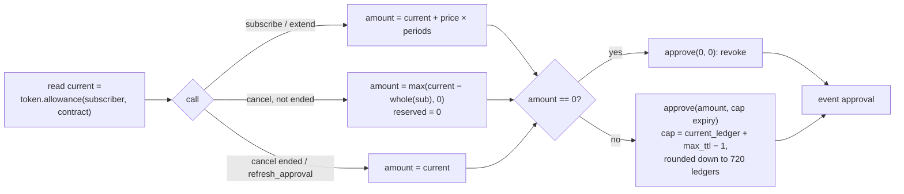

## 6. Subscription Lifecycle

Every subscriber method (`subscribe`, `extend`, `cancel`, `refresh_approval`) requires `subscriber` authorization and ends with one `approve` of the contract as spender. The contract reads the token's current allowance and approves that amount **plus or minus the call's own change** ([6.6](#66-the-shared-allowance)). The subscriber's signature covers that inner `approve` call, its amount and its expiry.

### 6.1 Subscribe

#### `subscribe(subscriber: Address, service_id: u64, periods: u64, claim_trial: bool) -> u64`

Creates a subscription and returns its `sub_id`.

| Param | Type | Description |
|---|---|---|
| `subscriber` | `Address` | The paying wallet |
| `service_id` | `u64` | Service to subscribe to |
| `periods` | `u64` | Number of future periods to budget for. May be 0. |
| `claim_trial` | `bool` | Ask for the free trial. Ignored if the service has no trial. |

Steps, in order:

1. The service must exist (`ServiceNotFound`) and be `Open` (`ServiceNotOpen`).
2. If `ActiveSub(subscriber, service_id)` points to a subscription that has not ended: `AlreadySubscribed`. A cancelled subscription that is still inside its paid period counts as not ended.
3. `reserved = price × periods` (`AmountOverflow`).
4. Allowance step: read `current` from the token once and compute `amount = current + reserved` (`AmountOverflow`). Nothing later in the call changes the allowance before the approve; the first payment is a plain `transfer`.
5. Decide trial or first payment (below) and compute `period_end_ts` (`TimestampOverflow`).
6. Approval horizon ([6.6](#66-the-shared-allowance)): `check_horizon(period_end_ts, k = periods)`, else `BeyondApprovalHorizon`. This runs before `TrialUsed` is set and before the first payment.
7. Set `TrialUsed`, or make the first payment.
8. Save the subscription with `created_ts = now`. `created_ts` is never changed afterwards. Set `ActiveSub(subscriber, service_id) = sub_id`.
9. Append `sub_id` to the wallet index (`WalletSubs`, `WalletSubCount`). Emit `sub_new` (with `created_ts`).
10. `approve(subscriber, contract, amount, cap expiry)`. Emit `approval`.

There is no limit on the number of live subscriptions per wallet.

**Trial or first payment.** A trial is granted when `claim_trial` is true, `trial_period_secs > 0` and `TrialUsed(subscriber, service_id)` is not set. `TrialUsed` is read only when the first two are true.

| Case | Money moved now | `period_end_ts` | `paid_periods` | Other |
|---|---|---|---|---|
| Trial | none | `now + trial_period_secs` | 0 | sets `TrialUsed` |
| No trial | `token.transfer(subscriber → merchant, price)` | `now + period_secs` | 1 | — |

The first payment is a plain transfer the subscriber signs. It does not come from the allowance or from `reserved`.

**What the subscriber approves.** The subscriber signs one transaction that contains:

- the first payment, if there is no trial: exactly `price`, to the service's `merchant`;
- one `approve` of the contract as spender, for the token's current allowance plus `price × periods`, with the cap expiry.

Examples for a service at 5 Pi per 30 days:

| `periods` | `claim_trial` (service has a 7-day trial, unused) | Paid now | `reserved` | Charges that can follow |
|---|---|---|---|---|
| 5 | `true` | 0 | 25 Pi | 5, the first at the end of the trial. Last window closes at day 7 + 5 × 30 = 157. |
| 4 | `false` | 5 Pi | 20 Pi | 4, the first after 30 days. Last window closes at day 30 + 4 × 30 = 150. |
| 5 | `false` | — | — | refused: `BeyondApprovalHorizon` (day 30 + 5 × 30 = 180 is beyond the horizon of about 173 days) |
| 0 | `false` | 5 Pi | 0 | none: one paid period, then it ends |
| 0 | `true` | 0 | 0 | none: trial only, then it ends |

For this service the most a subscriber can budget is 4 periods without a trial, or 5 periods with the 7-day trial.

**Errors:** `ServiceNotFound`, `ServiceNotOpen`, `AlreadySubscribed`, `AmountOverflow`, `TimestampOverflow`, `BeyondApprovalHorizon`. The call also fails if the token refuses the first payment (for example, low balance).

**Events:** `sub_new` (`amount` = first payment, 0 for a trial; includes `created_ts`), `approval`

### 6.2 Extend

#### `extend(subscriber: Address, sub_id: u64, periods: u64, expected_period_end: u64)`

Adds `price × periods` to the subscription's budget and the same amount to the allowance. Moves no money.

| Param | Type | Description |
|---|---|---|
| `subscriber` | `Address` | Must be the subscription's subscriber |
| `sub_id` | `u64` | Subscription to extend |
| `periods` | `u64` | Periods to add. May be 0: that only renews the allowance's expiry. |
| `expected_period_end` | `u64` | The `period_end_ts` the subscriber saw. Guards against a charge landing between reading and signing. |

Steps, in order:

1. The subscription must exist (`SubscriptionNotFound`), belong to `subscriber` (`Unauthorized`), and its service must exist (`ServiceNotFound`).
2. `period_end_ts` must equal `expected_period_end` (`PeriodMismatch`).
3. The subscription must not have ended: the window is still open, the service is not `Inactive`, and it is not past `period_end_ts` with `reserved < price`. Otherwise `SubscriptionEnded`.
4. `reserved += price × periods` (`AmountOverflow`).
5. Allowance step: read `current` once and compute `amount = current + price × periods` (`AmountOverflow`).
6. Approval horizon, only if `periods > 0`: `check_horizon(period_end_ts, k = reserved / price)`, where `k` is the whole periods of budget after the call. Otherwise `BeyondApprovalHorizon`.
7. Save the subscription. Emit `sub_ext`.
8. `approve(subscriber, contract, amount, cap expiry)`. Emit `approval`.

Because the check counts the whole budget after the call, a subscriber can top up only as far as the horizon allows. `extend` with `periods = 0` is never checked: it commits nothing new, and the allowance's expiry ledger, which only moves later, still covers every accepted budget.

An ended subscription never comes back. To continue after it ends, the subscriber calls `subscribe` again. A cancelled subscription that is still inside its paid period has not ended, so `extend` before `period_end_ts` gives it a new budget.

`extend` is also how a subscriber restores billing when the allowance has dropped below what a subscription needs (for example after a direct revoke). It adds `price × periods` to both the budget and the allowance, so it also raises what the subscriber commits. There is no call that re-covers a subscription's existing budget alone ([10.13](10-security-considerations.md#1013-accepted-limitation-uncovered-budgets-after-a-direct-revoke-or-lower)).

**Errors:** `SubscriptionNotFound`, `Unauthorized`, `ServiceNotFound`, `PeriodMismatch`, `SubscriptionEnded`, `AmountOverflow`, `BeyondApprovalHorizon`

**Events:** `sub_ext` (`amount` = budget added), `approval`

### 6.3 Cancel

#### `cancel(subscriber: Address, sub_id: u64)`

Stops all future charges. Needs only the subscriber's signature, so a subscriber can always stop paying.

Steps, in order:

1. The subscription must exist (`SubscriptionNotFound`), belong to `subscriber` (`Unauthorized`), and its service must exist (`ServiceNotFound`).
2. Allowance step: read `current` once; `amount = current`.
3. If `reserved > 0` and the subscription has not ended:
   - `amount = max(current − whole(sub), 0)`, where `whole(sub) = (reserved / price) × price`. The subtraction never fails.
   - Set `reserved = 0`, save it, and emit `sub_cncl`.
4. Otherwise (already cancelled, or ended) the subscription is not changed. An ended subscription's leftover budget stays in the allowance ([6.7](#67-per-subscription-guards-and-accepted-limitations)).
5. `approve(subscriber, contract, amount, cap expiry)`, or `approve(…, 0, 0)` when `amount` is 0. Emit `approval`. So cancelling an ended or already-cancelled subscription keeps the amount and only renews the expiry.

`period_end_ts` does not change, so access lasts to the end of the current paid or trial period. Status stays `Trial` or `Paid` until then, then becomes `Ended`.

`cancel` is idempotent: a second `cancel` subtracts nothing and only renews the allowance's expiry.

**Errors:** `SubscriptionNotFound`, `Unauthorized`, `ServiceNotFound`

**Events:** `sub_cncl` (`amount` = budget released), `approval`

### 6.4 Refresh approval

#### `refresh_approval(subscriber: Address)`

Reads `current` and approves it again with the cap expiry: `approve(subscriber, contract, current, cap expiry)` (a revoke if `current` is 0). It changes no subscription and no amount.

Use it to push the allowance's expiry later, for example before a long gap without other signed calls. Pi caps an allowance's life at about 180 days ([10.4](10-security-considerations.md#104-storage-expiry)). The approval horizon already keeps the allowance alive for every accepted budget.

It does not help once the allowance is 0 (revoked directly), because it keeps the amount. In that case the subscriber calls `extend` on the subscriptions to keep.

**Events:** `approval`

### 6.5 Process (batch charge)

#### `process(caller: Address, service_id: u64, items: Vec<ChargeItem>) -> Vec<ItemResult>`

Charges due subscriptions of one service. Returns one `ItemResult` per item, in order.

**Call-level checks**, in this order (the whole call fails):

| # | Check | Error |
|---|---|---|
| 1 | At most 15 items | `ProcessLimitTooHigh` |
| 2 | `caller` authorization | host auth error |
| 3 | The service exists | `ServiceNotFound` |
| 4 | `caller` is the service's `merchant` or its `Executor(service_id)` | `NotProcessExecutor` |

**Charge rule, per item.** Checks run in order; the first that fails decides the outcome. A failed check changes nothing.

| # | Check | If it fails |
|---|---|---|
| 1 | The `sub_id` exists | `Ended` |
| 2 | `sub.service_id == service_id` and `period_end_ts == expected_period_end` | `AlreadyHandled` |
| 3 | `now >= period_end_ts` | `NotDue` |
| 4 | `now < period_end_ts + period_secs` | `Stale` |
| 5 | `reserved >= price` | `Exhausted` |
| 6 | Service is not `Inactive` | `Ended` |
| 7 | The token allowance is not 0 | `ApprovalLost` |
| 8 | `try_transfer_from(contract, subscriber → merchant, price)` succeeds | `ChargeFailed` |
| ✓ | — | `Charged` |

The allowance in step 7 is read from the token once per subscriber per call, then lowered by `price` after each charge in the same call.

**On `Charged`:**

1. `period_end_ts += period_secs`, `reserved -= price`, `paid_periods += 1`.
2. The token lowers the allowance by `price` itself. `process` never calls `approve`; that needs the subscriber's signature.
3. Event `charged`. Then `low_bal` if the subscriber's balance is now below `price`, and `low_alw` if the allowance is now below `price`.

**On every other outcome:** nothing is written.

- `ApprovalLost` means the allowance is 0: revoked directly, or expired after every accepted budget ended.
- `ChargeFailed` means the allowance is non-zero but the transfer failed: the balance is too low, or the allowance is below the price.
- In both cases the subscription stays `Due`, and later runs can retry until its window closes. After that it returns `Stale`. The subscriber can fix the cause by topping up the wallet or calling `extend`.

**Idempotency.** `expected_period_end` is the key. After a charge, `period_end_ts` has moved, so the same item sent again returns `AlreadyHandled` and charges nothing. A retried or duplicated batch is a no-op. The window rule is what makes paying twice for one period impossible; `expected_period_end` makes retries safe.

**No partial failure.** One bad item never fails the batch. A failed transaction still costs fees on Soroban, so outcomes are reported per item and the call succeeds overall.

**Batch cap.** 15 items per call. The cap keeps the worst case under Pi Testnet's per-transaction limits:

| Limit | Value |
|---|---|
| Event bytes | 16,384 |
| Write entries | 200 |
| Write bytes | 132,096 |
| Disk reads | 200 |
| Footprint entries | 400 |
| Instructions | 400M |

The merchant's billing client (for example the server SDK's `processDue`) should simulate each batch first, and split it if the simulation exceeds a limit.

**Who calls it.** The contract does not schedule charges. The merchant's server (or any process holding the merchant or executor key) keeps its own list of subscriptions, reads their `period_end_ts`, and sends the due ones. A charge can land any time inside its window, so a late run still collects the period without shifting the next one.

### 6.6 The shared allowance

The Pi token keeps **one allowance per (subscriber, contract)**. It is shared by all of that subscriber's subscriptions in this contract, and only the subscriber's signature can change it. The contract does not keep its own copy of that number. Every subscriber-signed call reads the token's current value and adds or subtracts only its own change.

`current = token.allowance(subscriber, contract)`: the amount only. It is 0 if the allowance expired or was revoked. The token does not return the expiry.

Each call reads `current` once, at the start of its allowance step, and nothing in the call changes the allowance before the approve. In `subscribe` that read comes before the first-payment `transfer` and before the subscription is saved; the transfer does not touch the allowance.

| Call | `approve(subscriber, contract, amount, expiry)` |
|---|---|
| `subscribe(…, periods, …)` | `amount = current + price × periods`. The first payment is a direct `transfer`, not from the allowance. |
| `extend(…, periods, …)` | `amount = current + price × periods` |
| `cancel(sub)`, sub not ended | `amount = max(current − whole(sub), 0)`, then `reserved = 0` |
| `cancel(sub)`, sub ended | no change to the subscription; `amount = current` |
| `refresh_approval` | `amount = current`: renews the expiry only |
| `process`, successful charge | no `approve` (needs the subscriber's signature). The token lowers the allowance by `price` during `transfer_from`. |

Rules for every approve:

| Part | Rule |
|---|---|
| Amount | As in the table. Additions are checked (`AmountOverflow`); the subtraction in `cancel` saturates at 0. A wallet whose allowance is near the `i128` maximum (for example after a huge direct `approve`) gets `AmountOverflow` on `subscribe` or `extend` with `periods > 0` until it lowers the allowance. |
| Amount 0 | `approve(subscriber, contract, 0, 0)`: revoke |
| Expiry | Always the cap: `current_ledger + max_ttl − 1`, rounded **down** to a multiple of 720 ledgers (about 1 hour), where `max_ttl` is the network's maximum entry TTL as reported to contracts (about 180 days on Pi). If rounding down would not land after the current ledger, the unrounded cap is used. |
| Event | `approval {amount, expiration_ledger}` after each approve |

**Why the expiry is always the cap.** The contract cannot read the existing expiry, and it must not shorten the coverage of the subscriber's other subscriptions. Rounding down to a 720-ledger bucket makes simulation and execution agree, except at a bucket edge ([10.10](10-security-considerations.md#1010-known-limitation-approve-expiry-mismatch)).

As a result, an allowance lapses only about 180 days after the wallet's last signed call on this contract.

**Approval horizon.** `subscribe` and `extend` (with `periods > 0`) refuse a budget whose last possible charge falls after the expiry they set:

```
horizon_ts = now + (approval_cap() − current_ledger) × 5 s − HORIZON_MARGIN    // HORIZON_MARGIN = 7 days
check_horizon(period_end_ts, k, period_secs):
    k <= 0                                         → passes
    period_end_ts + k × period_secs <= horizon_ts  → passes
    otherwise                                      → BeyondApprovalHorizon (23)
```

| Call | `period_end_ts` used | `k` |
|---|---|---|
| `subscribe` | the new subscription's: `now + trial_period_secs` with a trial, else `now + period_secs` (the first, directly paid period counts) | `periods` |
| `extend`, `periods > 0` | the stored one | `reserved / price` after adding `periods` |
| `extend`, `periods = 0` | not checked | — |

`horizon_ts` is about 173 days ahead: the expiry is about 180 days (`max_ttl`), rounded down to 720 ledgers, minus the 7-day margin. The margin covers drift between ledger time and 5 seconds per ledger.

`period_end_ts + k × period_secs` is when the window of the last budgeted charge closes. Later signed calls only move the allowance's **expiry ledger** later (`approval_cap()` never decreases), so **the allowance can no longer expire while an accepted budget remains, as long as ledgers average at least about 4.81 s** ([10.15](10-security-considerations.md#1015-known-limitation-ledger-speed-and-the-approval-horizon)). `horizon_ts` itself can move slightly earlier within a 720-ledger bucket when ledgers run faster than 5 s; the guarantee rests on the expiry ledger. Only a direct revoke or lower in the token, or a `cancel` under contention, can still leave live subscriptions uncovered ([10.13](10-security-considerations.md#1013-accepted-limitation-uncovered-budgets-after-a-direct-revoke-or-lower)).

At `subscribe`, the first period counts: without a trial, `period_end_ts = now + period_secs`, so even one prepaid period needs `2 × period_secs <= about 173 days`.

| Service period | Most prepaid periods at `subscribe` (no trial) | With a 7-day trial | Renewing later |
|---|---|---|---|
| Weekly (7 days) | 23 (after the paid first week: about 24 weeks in total) | 23 | `extend` as the budget runs down |
| Monthly (30 days) | 4 (last window at day 150) | 5 (last window at day 157) | `extend` as the budget runs down |
| Quarterly (90 days) | 0: no prepaid budget at `subscribe` (90 + 90 = 180) | 1 (7 + 90 = 97) | one period at a time, by an `extend` made late in the paid period (see below) |
| about 86.5 to about 173 days | 0 | 1 if `trial_period_secs + period_secs <= about 173 days`, else 0 | one period at a time, by an `extend` made late in the paid period |
| about 173 days or more | 0 | 0 | never through the allowance: subscribe with `periods = 0` and pay each period by subscribing again |

**Renewing a long-period service.** For a period between about 86.5 and about 173 days, subscribe with `periods = 0` (the first period is paid directly). Then call `extend(periods = 1)` once `period_end_ts + period_secs <= horizon_ts`, that is, once `period_end_ts` is within about `173 days − period_secs` of now. This must happen before `period_end_ts`: a subscription with no budget ends at `period_end_ts`, and an ended subscription cannot be extended. Repeat each period.

| Other consequence | Detail |
|---|---|
| Prepay limit | The last budgeted window must close within about 173 days, so a subscriber can prepay at most about 170 days ahead. |
| Top-ups | `extend` checks the whole budget after the call, so it can add only as many periods as the horizon allows at that time. |

**When a subscription has ended.**

```
ended = now >= period_end_ts
        && (reserved < price || now >= period_end_ts + period_secs || service.state == Inactive)
```

Once a subscription has ended, it stays ended: no call can raise its `reserved` or move its `period_end_ts`.



### 6.7 Per-subscription guards and accepted limitations

The token allowance is one shared number. What keeps each subscription to its own share is the contract's per-subscription guards, not the allowance.

**Per-subscription guards.** A charge needs all of these:

- the subscription's own charge window: `period_end_ts <= now < period_end_ts + period_secs`;
- its own budget: `reserved >= price`;
- the exact `expected_period_end`;
- a caller that is the merchant or executor of **that** subscription's service.

The transfer is always exactly `price`, to **that** service's merchant, and `reserved` drops by `price` each time. So a subscription can never take more than the budget the subscriber gave it, nor more than once per period.

Therefore the wallet's total outflow through this contract is at most the sum, over its subscriptions, of the budgets the subscriber authorized, whatever the token allowance says.

**Accepted limitation: the shared number.**

- The allowance can be lower than the sum of the live budgets after a direct revoke or lower in the token, or after a `cancel` under contention. It cannot lapse while an accepted budget remains (approval horizon, [6.6](#66-the-shared-allowance)), as long as ledgers average at least about 4.81 s ([10.15](10-security-considerations.md#1015-known-limitation-ledger-speed-and-the-approval-horizon)).
- In that case, charges of different subscriptions compete for it, first come first served.
- A subscription's legitimate charge can then use headroom that the subscriber added when signing for **another** subscription. That other subscription's charge then fails (`ChargeFailed` or `ApprovalLost`). It is retried, and no money is lost.
- Recovery: the subscriber extends the failing subscription, or approves directly in the token. Extending also raises that subscription's budget; there is no call that re-covers an existing budget alone ([10.13](10-security-considerations.md#1013-accepted-limitation-uncovered-budgets-after-a-direct-revoke-or-lower)).
- No subscription ever pays more than its own budget.

Example:

| Step | Allowance | What happens |
|---|---|---|
| A and B are live, each with budget left. The subscriber revokes the allowance directly in the token. | 0 | Charges of A and B return `ApprovalLost` |
| The subscriber subscribes to C with 3 periods | `0 + C's budget` | Only C's budget is approved |
| A and B are due before C | lowered by A's and B's prices | A and B charge from C's headroom, each within its own budget |
| C is due | not enough | C returns `ChargeFailed` or `ApprovalLost`, retried. The subscriber extends C. |

**Accepted limitation: lingering budget.**

- A subscription can end without being charged: its window passes, or its service becomes `Inactive`. Its budget stays in the allowance.
- The contract does not clean it up for now. The ended subscription cannot spend it.
- It adds headroom that other live subscriptions can use, each within its own budget.
- `cancel` before a subscription ends removes its budget from the allowance. `cancel` after it ends changes nothing.

**What changes the token allowance.**

| Trigger | Signed by | Token allowance |
|---|---|---|
| `subscribe`, `extend` | subscriber | `current + price × periods`, cap expiry |
| `cancel` (not ended) | subscriber | `current − whole(sub)` (not below 0), cap expiry |
| `cancel` (ended), `refresh_approval` | subscriber | `current`, cap expiry |
| A charge succeeds | merchant or executor | the token lowers it by `price` |
| Any other charge outcome | merchant or executor | unchanged |
| Direct `approve` in the token | subscriber | whatever the subscriber sets; the next signed call adds to or subtracts from that value |
| Expiry (about 180 days after the last signed call; by the approval horizon, only after every accepted budget's last window has closed) | — | becomes 0 |

### 6.8 Status

Status is derived when read, never stored ([3.3](3-data-types.md#33-views)). It comes from the `Sub` record, its service and the clock only. It does not read the token.

| Status | Condition | Active |
|---|---|---|
| `Trial` | `now < period_end_ts` and `paid_periods == 0` | yes |
| `Paid` | `now < period_end_ts` and `paid_periods > 0` | yes |
| `Due` | `period_end_ts <= now < period_end_ts + period_secs` and `reserved >= price` and service not `Inactive` | yes |
| `Ended` | otherwise | no |

Typical paths:

| Path | Status over time |
|---|---|
| Trial, then renews | `Trial` → `Due` → `Paid` → `Due` → `Paid` … |
| Paid, budget runs out | `Paid` → `Due` … `Paid` → `Ended` (at `period_end_ts` once `reserved < price`) |
| Cancel | `Paid` → `Paid` (to `period_end_ts`) → `Ended` |
| Charge fails, then the subscriber tops up | `Due` (`ChargeFailed`, retried) → `Paid` |
| Allowance revoked directly, subscriber extends in time | `Due` (`ApprovalLost`, retried) → `extend` → `Paid` |
| Allowance revoked directly, subscriber does nothing | `Due` (`ApprovalLost`, retried) → `Ended` (when the window closes) |
| Charge keeps failing, or nobody bills it | `Paid` → `Due` → `Ended` (when the window closes) |
| Service made `Inactive` | `Paid` → `Ended` (at `period_end_ts`) |

`Ended` is final. Any budget it had left stays in the allowance ([6.7](#67-per-subscription-guards-and-accepted-limitations)).

Next: [`7-Query-Methods`](7-query-methods.md)
