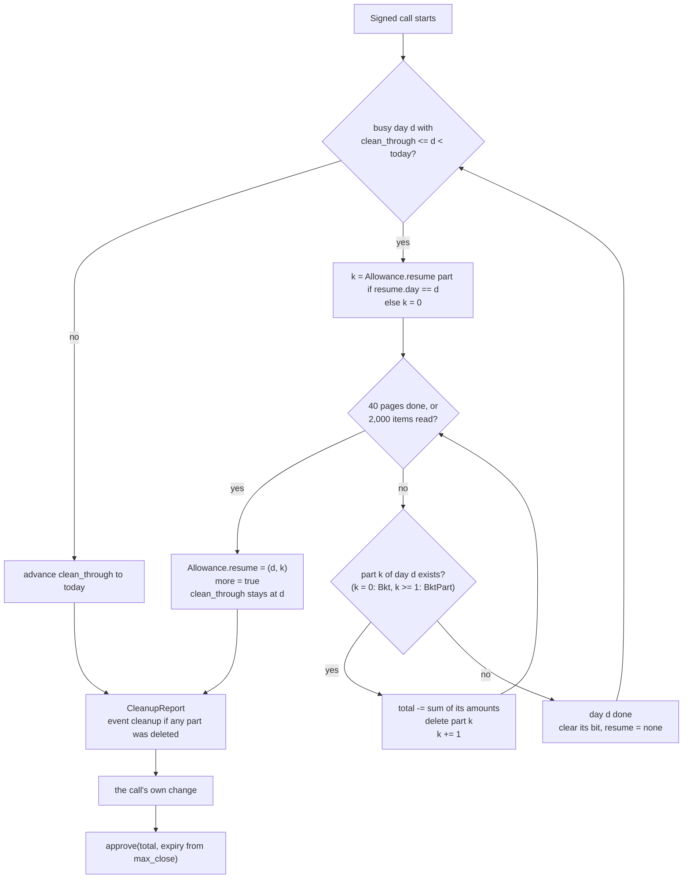

## 6. Subscription Lifecycle

Every subscriber method (`subscribe`, `extend`, `cancel`, `refresh_approval`) requires `subscriber` authorization. Each one:

1. first runs **cleanup** ([6.6](#66-cleanup)): it releases the budget of ended subscriptions from whole past UTC days;
2. then applies its own change;
3. ends by **setting** the token allowance to the wallet's `total` ([6.7](#67-keeping-the-allowance-in-sync)).

The subscriber's signature covers that inner `approve` call, its amount and its expiry. Each method returns a `CleanupReport`, inside `SubscribeResult` for `subscribe`.

### 6.1 Subscribe

#### `subscribe(subscriber: Address, service_id: u64, periods: u64, claim_trial: bool) -> SubscribeResult`

Creates a subscription. Returns its `sub_id` and the cleanup report.

| Param | Type | Description |
|---|---|---|
| `subscriber` | `Address` | The paying wallet |
| `service_id` | `u64` | Service to subscribe to |
| `periods` | `u64` | Number of future periods to budget for. May be 0. |
| `claim_trial` | `bool` | Ask for the free trial. Ignored if the service has no trial. |

Steps, in order:

1. Cleanup.
2. The service must exist (`ServiceNotFound`) and be `Open` (`ServiceNotOpen`).
3. If `ActiveSub(subscriber, service_id)` points to a subscription that has not ended: `AlreadySubscribed`. A cancelled subscription that is still inside its paid period counts as not ended.
4. `reserved = price × periods` (`AmountOverflow`).
5. Trial or first payment (below). `period_end_ts` is computed with `TimestampOverflow` checks.
6. Save the subscription. Set `ActiveSub(subscriber, service_id) = sub_id`.
7. Append `sub_id` to the wallet index (`WalletSubs`, `WalletSubCount`).
8. If `amount > 0`: add the item `(sub_id, amount)` to the bucket of `day(deadline)` ([6.7](#67-keeping-the-allowance-in-sync)), add `amount` to `total`, and raise `max_close` to this subscription's `final_close`.
9. Set the allowance to `total`.

There is no limit on the number of live subscriptions per wallet.

**Trial or first payment.** A trial is granted when `claim_trial` is true, `trial_period_secs > 0` and `TrialUsed(subscriber, service_id)` is not set. `TrialUsed` is read only when the first two are true.

| Case | Money moved now | `period_end_ts` | `paid_periods` | Other |
|---|---|---|---|---|
| Trial | none | `now + trial_period_secs` | 0 | sets `TrialUsed` |
| No trial | `token.transfer(subscriber → merchant, price)` | `now + period_secs` | 1 | — |

The first payment is a plain transfer the subscriber signs. It does not come from the allowance or from `reserved`.

**What the subscriber approves.** The subscriber signs one transaction that contains:

- the first payment, if there is no trial: exactly `price`, to the service's `merchant`;
- one `approve` of the contract as spender, for the wallet's new `total`: this subscription's `price × periods`, plus every other subscription still in a bucket after cleanup. The expiry is set from `max_close`.

Examples for a service at 5 Pi per 30 days:

| `periods` | `claim_trial` (service has a 7-day trial, unused) | Paid now | `reserved` | Charges that can follow |
|---|---|---|---|---|
| 12 | `true` | 0 | 60 Pi | 12, the first at the end of the trial |
| 12 | `false` | 5 Pi | 60 Pi | 12, the first after 30 days |
| 0 | `false` | 5 Pi | 0 | none: one paid period, then it ends |
| 0 | `true` | 0 | 0 | none: trial only, then it ends |

**Errors:** `ServiceNotFound`, `ServiceNotOpen`, `AlreadySubscribed`, `AmountOverflow`, `TimestampOverflow`. The call also fails if the token refuses the first payment (for example, low balance).

**Events:** `cleanup` (if anything was cleaned), `sub_new` (`amount` = first payment, 0 for a trial), `approval`

### 6.2 Extend

#### `extend(subscriber: Address, sub_id: u64, periods: u64, expected_period_end: u64) -> CleanupReport`

Adds `price × periods` to the subscription's budget. Moves no money.

| Param | Type | Description |
|---|---|---|
| `subscriber` | `Address` | Must be the subscription's subscriber |
| `sub_id` | `u64` | Subscription to extend |
| `periods` | `u64` | Periods to add. May be 0: that only re-approves. |
| `expected_period_end` | `u64` | The `period_end_ts` the subscriber saw. Guards against a charge landing between reading and signing. |

Steps, in order:

1. Cleanup.
2. The subscription must exist (`SubscriptionNotFound`), belong to `subscriber` (`Unauthorized`), and its service must exist (`ServiceNotFound`).
3. `period_end_ts` must equal `expected_period_end` (`PeriodMismatch`).
4. The subscription must not have ended: the window is still open, the service is not `Inactive`, and it is not past `period_end_ts` with `reserved < price`. Otherwise `SubscriptionEnded`.
5. `reserved += price × periods` (`AmountOverflow`).
6. If the new `amount > 0`:
   - set the subscription's item in the bucket of `day(deadline)` to the new amount;
   - if it had no item (it was cancelled inside its period, or subscribed with `periods = 0`), add one;
   - add the difference to `total`;
   - raise `max_close` to the subscription's new `final_close`.
7. Set the allowance to `total`. This also renews the allowance's expiry.

An ended subscription never comes back. To continue after it ends, the subscriber calls `subscribe` again. A cancelled subscription that is still inside its paid period has not ended, so `extend` before `period_end_ts` undoes the cancel.

**Errors:** `SubscriptionNotFound`, `Unauthorized`, `ServiceNotFound`, `PeriodMismatch`, `SubscriptionEnded`, `AmountOverflow`

**Events:** `cleanup` (if anything was cleaned), `sub_ext` (`amount` = budget added), `approval`

### 6.3 Cancel

#### `cancel(subscriber: Address, sub_id: u64) -> CleanupReport`

Stops all future charges. Needs only the subscriber's signature, so a subscriber can always stop paying.

Steps, in order:

1. Cleanup.
2. The subscription must exist (`SubscriptionNotFound`), belong to `subscriber` (`Unauthorized`), and its service must exist (`ServiceNotFound`).
3. If `reserved > 0` and the subscription has not ended:
   - remove its item from the bucket of `day(deadline)` and subtract the item's amount from `total`;
   - set `reserved = 0`, save it, and emit `sub_cncl`.
4. Set the allowance to `total`, or revoke it (`approve(…, 0, 0)`) if `total` is 0.

`period_end_ts` does not change, so access lasts to the end of the current paid or trial period. Status stays `Trial` or `Paid` until then, then becomes `Ended`.

`cancel` is idempotent. Cancelling an already cancelled or ended subscription changes nothing for that subscription. Cleanup and the re-approve still run.

**Errors:** `SubscriptionNotFound`, `Unauthorized`, `ServiceNotFound`

**Events:** `cleanup` (if anything was cleaned), `sub_cncl` (`amount` = budget released; only when step 3 runs), `approval`

### 6.4 Refresh approval

#### `refresh_approval(subscriber: Address) -> CleanupReport`

Runs cleanup and sets the allowance to `total` with a new expiry. It does not change any subscription record.

Use it to:

- renew an allowance that will expire soon (Pi caps an allowance's life at about 180 days, see [10.4](10-security-considerations.md#104-storage-expiry));
- release the budget of ended subscriptions, including the next 40 pages when a previous call reported `more = true`;
- restore billing after the allowance expired or was revoked, or after the subscriber lowered it directly in the token.

**Events:** `cleanup` (if anything was cleaned), `approval`

### 6.5 Process (batch charge)

#### `process(caller: Address, service_id: u64, items: Vec<ChargeItem>) -> Vec<ItemResult>`

Charges due subscriptions of one service. Returns one `ItemResult` per item, in order.

**Call-level checks**, in this order (the whole call fails):

| # | Check | Error |
|---|---|---|
| 1 | At most 15 items | `ProcessLimitTooHigh` |
| 2 | `caller` authorization | host auth error |
| 3 | The service exists | `ServiceNotFound` |
| 4 | `caller` is the service's `merchant` or its `Executor(service_id)` | `NotProcessExecutor` |

**Charge rule, per item.** Checks run in order; the first that fails decides the outcome. A failed check changes nothing.

| # | Check | If it fails |
|---|---|---|
| 1 | The `sub_id` exists | `Ended` |
| 2 | `sub.service_id == service_id` and `period_end_ts == expected_period_end` | `AlreadyHandled` |
| 3 | `now >= period_end_ts` | `NotDue` |
| 4 | `now < period_end_ts + period_secs` | `Stale` |
| 5 | `reserved >= price` | `Exhausted` |
| 6 | Service is not `Inactive` | `Ended` |
| 7 | The subscription's item is in the bucket of `day(deadline)` (any part) | `Ended` |
| 8 | The token allowance is not 0 | `ApprovalLost` |
| 9 | `try_transfer_from(contract, subscriber → merchant, price)` succeeds | `ChargeFailed` |
| ✓ | — | `Charged` |

Step 7 is a backstop: every subscription with budget left has its item in its deadline's bucket.

The allowance in step 8 is read from the token once per subscriber per call, then lowered by `price` after each charge in the same call.

**On `Charged`:**

1. `period_end_ts += period_secs`, `reserved -= price`, `paid_periods += 1`. The token lowers the allowance by `price` itself.
2. The item moves, using the position step 7 found. If budget is left and the new deadline falls on the same UTC day (a period shorter than a day), its amount is updated in place. Otherwise it is removed from the old day in place and, if budget is left, added to the bucket of the new deadline (one period later) with the lower amount.
3. `total` moves by exactly what the buckets changed: minus the old item's amount, plus the new item's amount (0 if none). While the invariant holds this equals `total -= price`. If `total` reaches 0, `max_close` resets. `process` writes the `Allowance` record only if it changed and never deletes it.
4. Event `charged`. Then `low_bal` if the subscriber's balance is now below `price`, and `low_alw` if the allowance is now below `price`.

Because `process` moves every charged subscription forward at once, any item still in a bucket after its day has passed was not charged in its window. That subscription has ended.

**On every other outcome:** nothing is written.

- `ApprovalLost` means the allowance expired or was revoked. Any call the subscriber signs (for example `refresh_approval`) re-approves `total`, after which a retry can succeed.
- `ChargeFailed` means the allowance is non-zero but the transfer failed: the balance is too low, or the subscriber lowered the allowance below the price. The subscriber can top up, or call `refresh_approval` or `extend`.
- In both cases the subscription stays `Due`, and later runs can retry until its window closes. After that it returns `Stale`, and cleanup releases its item once that day has passed.

`process` touches only the buckets of the subscriptions it charges. It never cleans other days and cannot change the token allowance.

**Idempotency.** `expected_period_end` is the key. After a charge, `period_end_ts` has moved, so the same item sent again returns `AlreadyHandled` and charges nothing. A retried or duplicated batch is a no-op. The window rule is what makes paying twice for one period impossible; `expected_period_end` makes retries safe.

**No partial failure.** One bad item never fails the batch. A failed transaction still costs fees on Soroban, so outcomes are reported per item and the call succeeds overall.

**Batch cap.** 15 items per call. The cap keeps the worst case under Pi Testnet's per-transaction limits:

| Limit | Value |
|---|---|
| Event bytes | 16,384 |
| Write entries | 200 |
| Write bytes | 132,096 |
| Disk reads | 200 |
| Footprint entries | 400 |
| Instructions | 400M |

Write bytes are the tightest. One charge can rewrite two full bucket parts: the old day's part the item leaves and the new day's part it joins. The part size, 64 items, is chosen so that 15 such charges fit.

| Part size | Worst-case `process` ×15 (two full parts rewritten per item) |
|---|---|
| 400 items | 552,416 bytes: over the 132,096 limit (already at 4 items) |
| 100 items | 156,416 bytes: over the limit |
| **64 items** | **108,896 bytes (measured): fits** |

With 400-item parts, an attacker could cheaply fill parts using trial services and make a merchant's whole batch fail.

The merchant's billing client (for example the server SDK's `processDue`) should still simulate each batch first, and split it if the simulation exceeds the write-byte limit.

**Who calls it.** The contract does not schedule charges. The merchant's server (or any process holding the merchant or executor key) keeps its own list of subscriptions, reads their `period_end_ts`, and sends the due ones. A charge can land any time inside its window, so a late run still collects the period without shifting the next one.

### 6.6 Cleanup

Cleanup runs at the start of every subscriber-signed call. It releases the budget of subscriptions that ended without being charged, one day bucket at a time:

```
cleanup(subscriber):
  for each busy day d with clean_through <= d < today, oldest first,
  at most 40 pages (parts) per call:
      start at part 0, or at Allowance.resume's part if this day was stopped earlier
      read parts k, k+1, ... until a part key does not exist:
          total -= sum of the amounts in the part; delete the part
      before each part: if 40 pages were done, or 2,000 items were read in this call:
          Allowance.resume = (d, next part); more = true; stop (the next call continues here)
      day d done: clear its busy bit; resume = none
  advance clean_through to the first day not yet cleaned (at most today)
  return CleanupReport { days_cleared, released, more }
```

| Property | Detail |
|---|---|
| What it reads | Only the wallet's `Allowance` record and the parts of its past buckets. It never reads `Sub` or `Service`: an item still in a past day's bucket belongs to a subscription that was not charged in its window, so it has ended. |
| Which days | Whole past UTC days only. Today's bucket waits until tomorrow, so the approval can carry up to about one day of extra budget. |
| Limit | Cleanup stops at whichever comes first: 40 pages, or 2,000 items read in the call (`CLEAN_ITEM_BUDGET`). Each part (part 0 or an overflow part) read and deleted is one page. The read of the missing key that ends a day's chain is not a page. The item budget is checked before each part, so a call reads at most about 2,063 items (about 92 KB). 40 pages of full 64-item parts would be 2,560 items, so the budget binds only for backlogs of mostly full parts. |
| Why an item budget | Pi counts the restore of archived past parts against the per-transaction limits on disk reads (200,000 bytes) and write bytes (132,096). A backlog beyond those limits would make every signed call of that wallet fail, `cancel` included, and the wallet would stay stuck. The budget keeps each call's cleanup to about 92 KB of parts. Normal backlogs, a few items per day, never reach it; for them the 40-page limit applies. |
| Failure | Cleanup never fails, and it never makes the user's action fail. |
| Backlog | If `more = true`, `total` still includes some ended subscriptions. A day stopped part-way is recorded in `Allowance.resume`; `clean_through` stays at that day. The approval is then **higher** than needed, never lower. Each further signed call, for example `refresh_approval`, cleans up to 40 more pages. |
| Simulation | Simulation and execution see the same past days, so the report matches, except across a UTC midnight. See [10.11](10-security-considerations.md#1011-known-limitation-utc-midnight-between-simulation-and-execution). |
| Event | `cleanup`, topic `[cleanup, subscriber]`, data `CleanupReport`, when at least one bucket part was deleted |

A wallet can see its backlog with `get_allowance(subscriber).pending_days` before signing anything.



### 6.7 Keeping the allowance in sync

The Pi token keeps one allowance per (subscriber, contract). Only the subscriber's signature can change it. So the contract keeps its own exact summary, `Allowance.total`, and sets the token's number to it whenever the subscriber signs.

**When a subscription has ended.**

```
ended = now >= period_end_ts
        && (reserved < price || now >= period_end_ts + period_secs || service.state == Inactive)
```

Once a subscription has ended, it stays ended: no call can raise its `reserved` or move its `period_end_ts`.

**Day buckets.** Each subscription with budget left is in exactly one bucket: the UTC day its current charge window closes, `day(period_end_ts + period_secs)`. The bucket holds `(sub_id, amount)`, where `amount = (reserved / price) × price`. `Allowance.total` is the sum of every item in the wallet's buckets.

**Overflow parts.** A day's bucket is part 0 (`Bkt`) plus zero or more overflow parts (`BktPart`), each holding at most 64 items (`PART_CAP`). Items are not sorted; the order within a day never matters.

| Operation | How |
|---|---|
| Chain | Part 0 is `Bkt(subscriber, day)`; overflow parts are `BktPart(subscriber, day, 1)`, `…, 2)`, … There is no part counter: the chain ends at the first key that does not exist. |
| Insert | Read parts 0, 1, … and append to the **first** part with room (fewer than 64 items), reusing holes left by removals. Only when every existing part is full does the scan reach the missing key; that part is then created. |
| Find (`cancel`, `extend`, a charge moving the item, the `process` membership check) | Read parts 0, 1, … and stop at the part that holds the `sub_id`. Only if it is not found does the scan continue to the missing key that ends the chain. |
| Remove | Remove the item in place and rewrite only that part. There is no refill. The part is kept even if it becomes empty, because deleting a middle part would break the chain. The day keeps its busy bit. |
| Update (`extend`) | Change the item's amount in place. |
| Cleanup | Read and delete every part of a past day until the missing key, each part counting as one page. If the 40-page limit stops it mid-day, `Allowance.resume` records `(day, next_part)` and the next cleanup continues there. |

Past days are touched only by cleanup. Charges land before the window closes (today or later), `cancel` on a subscription whose window closed changes nothing, and `extend` on it is refused. So a chain left part-way by an interrupted cleanup never meets an insert or a find.

The "next part doesn't exist" read is done only where the end of the chain matters: always in cleanup, in an insert when every part is full, and in a find that has not found the item yet. A normal day takes no extra read.

Cost on a normal day (at most 64 items): insert 1 read + 1 write; find or remove 1 read + 1 write; cleanup 1 read + 1 probe of the missing next key + 1 delete. A day with `k` parts: up to `k` reads to find, and `k` reads (+1 probe if all are full) to insert. A missing-key read costs one footprint entry and about 70 bytes of transaction size, possibly a disk read (to be measured).

**What changes `total` and the buckets.**

| Event | `total` | Buckets |
|---|---|---|
| `subscribe` (any caller, including direct RPC) | `+ amount` | add `(sub_id, amount)` to the deadline's day if `amount > 0`; append `sub_id` to `WalletSubs` |
| `extend(periods)` | `−` old item amount `+` new item amount, which is `+ price × periods` | update the item's amount in place; add an item if it had none |
| `cancel` | `−` the removed item's amount | remove the item in place; `reserved = 0` |
| `process`, successful charge | `−` old item amount `+` new item amount, which is `− price` while the invariant holds (the token lowers the allowance by `price`) | remove from the old deadline's day; if `amount − price > 0`, add to the next deadline's day with the lower amount (updated in place if that is the same day) |
| `process`, any other outcome | none | none |
| Cleanup of a past day | `−` the sum of that page | delete the page |

**Approve**, the last step of every subscriber-signed call:

```
token.approve(subscriber, contract, total, expiration_ledger)
```

| Part | Rule |
|---|---|
| Amount | `total`. Always a **set**, never an add. |
| Target time | `max(max_close, now) + 7 days`, where `max_close` is the latest `final_close` of any subscription added since `total` was last 0. Taking `now` when it is later keeps the expiry in the future while a cleanup backlog is left. |
| To a ledger | `current_ledger + ceil((target time - now) / 5)` |
| Rounding | Rounded **up** to a multiple of 720 ledgers (about 1 hour), so simulation and execution normally produce the same value and the subscriber's signature still matches |
| Cap | At most `current_ledger + max_ttl - 1`, where `max_ttl` is the network's maximum entry TTL as reported to contracts (about 180 days on Pi). The cap is rounded **down** to a multiple of 720 ledgers, so a capped value also stays the same between simulation and execution. |
| Nothing left | `total == 0` → `approve(subscriber, contract, 0, 0)`: revoke. `max_close` resets. The `Allowance` record is deleted once no busy day remains and no cleanup is in progress; until then it keeps tracking emptied days for cleanup. |
| Storing the summary | After the approve, the `Allowance` record is written only if it changed. Its TTL is extended either way. |

`max_close` only rises, on `subscribe` and `extend`. An expiry that is a little long is safe because the amount is accurate. The expiry itself is not stored in the contract. It lives in the token's own allowance entry (`["Allowance", {from, spender}]` → `{amount, live_until_ledger}`), which off-chain readers fetch directly.

**Approval invariant.** Between calls, `total` is at most the token allowance, unless the allowance expired or the subscriber edited it directly. Every signed call sets the allowance to `total`, and every charge lowers both by one price.

**Why the approval can be higher than needed.** A subscription can end without the subscriber signing anything: its window passes, or the service becomes `Inactive`. The contract cannot lower the token allowance then. Its item stays in its bucket until cleanup releases it at the subscriber's next signed call after that day. Until then, the approval includes that subscription's budget.

**Why that extra amount cannot be spent.**

- `transfer_from` is called only by `process`, only for an item that passes the charge rule.
- The charge rule takes at most one `price` per period, only from a subscription in its window with `reserved >= price`, and lowers `reserved` by the same amount.
- So total charges can never exceed the subscriptions' own `reserved` budgets, whatever the allowance says. A valid charge is never blocked by a pending cleanup.

**Expired or revoked allowance.** This needs no special case.

- An approval normally lapses only after `max_close` plus 7 days, by which time every subscription it covered has ended.
- A subscription can still be live when the allowance is 0: when its budget reaches past the approve cap (about 180 days), or after the subscriber revoked the allowance directly. Its charges return `ApprovalLost` (nothing changes, retried). The subscriber's next signed call re-approves `total`, which still includes it.

**Direct edits.** A subscriber can call the token's `approve` directly, outside this contract.

| Edit | Effect |
|---|---|
| Revoke (set to 0) | Charges return `ApprovalLost` and are retried; nothing changes. The next signed call re-approves `total`. |
| Lower, but not to 0 | Charges it cannot cover fail with `ChargeFailed` and are retried. The next signed call sets the allowance back to `total`. |
| Raise | No effect on what can be charged: each subscription still takes at most its `reserved`, one price per period. The next signed call sets it back to `total`. |

### 6.8 Status

Status is derived when read, never stored ([3.3](3-data-types.md#33-views-and-results)). It comes from the `Sub` record, its service and the clock only. It does not read buckets or the token.

| Status | Condition | Active |
|---|---|---|
| `Trial` | `now < period_end_ts` and `paid_periods == 0` | yes |
| `Paid` | `now < period_end_ts` and `paid_periods > 0` | yes |
| `Due` | `period_end_ts <= now < period_end_ts + period_secs` and `reserved >= price` and service not `Inactive` | yes |
| `Ended` | otherwise | no |

Typical paths:

| Path | Status over time |
|---|---|
| Trial, then renews | `Trial` → `Due` → `Paid` → `Due` → `Paid` … |
| Paid, budget runs out | `Paid` → `Due` … `Paid` → `Ended` (at `period_end_ts` once `reserved < price`) |
| Cancel | `Paid` → `Paid` (to `period_end_ts`) → `Ended` |
| Charge fails, then the subscriber tops up | `Due` (`ChargeFailed`, retried) → `Paid` |
| Allowance expired or revoked, subscriber signs in time | `Due` (`ApprovalLost`, retried) → `refresh_approval` → `Paid` |
| Allowance expired or revoked, subscriber does nothing | `Due` (`ApprovalLost`, retried) → `Ended` (when the window closes) |
| Charge keeps failing, or nobody bills it | `Paid` → `Due` → `Ended` (when the window closes) |
| Service made `Inactive` | `Paid` → `Ended` (at `period_end_ts`) |

`Ended` is final. Its budget, if any, is released from `total` by cleanup after its deadline's day has passed.

Next: [`7-Query-Methods`](7-query-methods.md)
